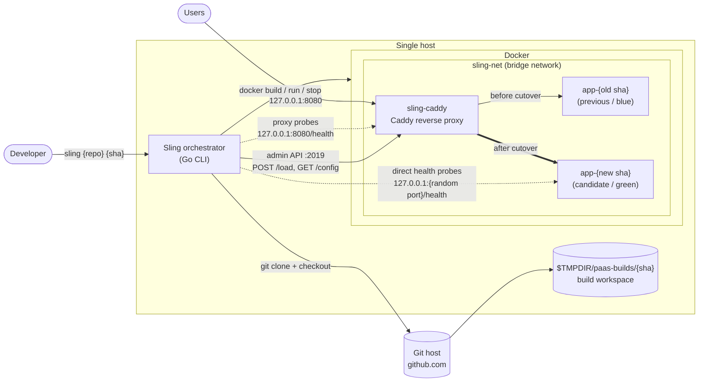
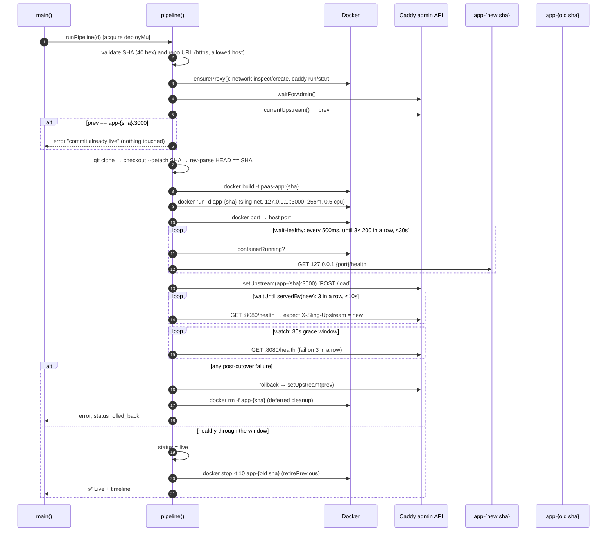
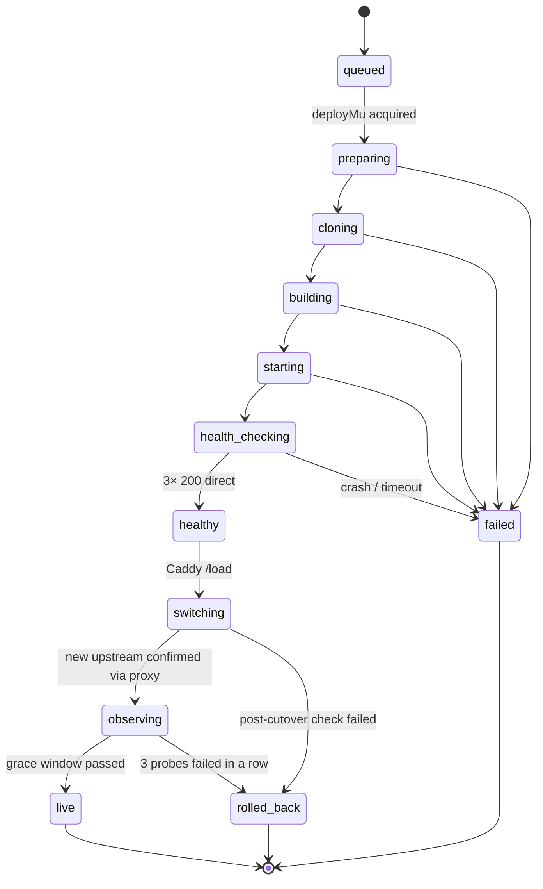
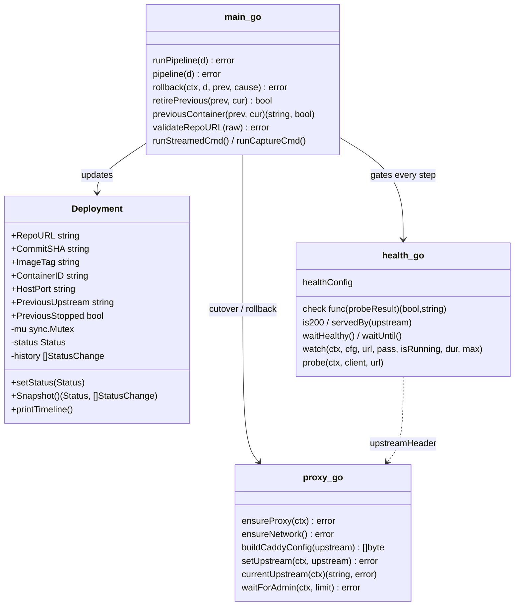

# Sling

**Push a commit, and it goes live with no downtime or rolls itself back.**
Sling is a small self-hosted deploy orchestrator written in Go. You give it a git
repo and an exact commit. It builds a Docker image, starts the new version beside
the old one, proves it is healthy, switches a Caddy proxy over to it, and keeps
watching. If anything fails along the way, traffic goes back to the previous version.

```
go run . https://github.com/you/app <40-char-commit-sha>
```

---

## The problem it solves

Deploying to your own server usually looks like this: SSH in, `git pull`,
`docker compose up -d --build`, and hope. That approach has a few problems:

- **Downtime on every deploy.** The old container is stopped before the new one is ready.
- **Broken releases reach users.** Nothing checks that the new version works
  before it gets traffic. A crash on boot or a failing `/health` means an outage.
- **Manual, stressful rollbacks.** When a release is bad, you are back on SSH
  rebuilding the old version while users wait.
- **"What is actually running?"** Branch names move. Without pinning, the
  server can end up on a different commit than the one you meant to ship.

Hosted platforms (Heroku, Render, Railway) solve this, but they cost money and
run your app on their infrastructure. Sling brings the same safety to a single
VPS that you own.

## What Sling guarantees

| Guarantee | How |
|---|---|
| **Builds exactly the commit you asked for** | Only full 40-hex SHAs are accepted. After `git checkout --detach` it compares `git rev-parse HEAD` with the SHA you gave it. |
| **No downtime** | The new container runs beside the old one. The proxy switches only after the new one passes its health checks. |
| **A broken build never gets traffic** | It needs 3 healthy `/health` responses in a row from the container directly. If the container crashes, the check fails at once. |
| **It checks the new version is the one answering** | After the switch it probes through the proxy and requires the `X-Sling-Upstream` header to name the *new* container, not just "something answered 200". |
| **Automatic rollback** | If the post-switch check or the 30s grace window fails (3 probes in a row), the proxy is pointed back at the previous version. |
| **Old connections finish cleanly** | The previous version is stopped with `docker stop` (SIGTERM, 10s to finish), not killed, and is kept so a manual rollback is just start + switch. |
| **Resource limits** | Each app gets 256 MB of memory and 0.5 CPU, and its port is reachable only from the server itself (loopback). |
| **One deploy at a time** | A lock stops two deploys from fighting over the proxy. |
| **Live commit is not redeployed** | Redeploying the commit that is already live is refused before any container is touched. |

## Who it is for

- **Solo developers and small teams** with one VPS who want safe, zero-downtime
  deploys without the bulk of a full self-hosted PaaS.
- **Learners** who want to see how blue/green deploys, health gating and
  rollback actually work. The codebase is small and heavily commented.

### How it compares

| | Sling | Kamal | Coolify / Dokploy | Dokku |
|---|---|---|---|---|
| Footprint | one Go binary + Caddy | Ruby gem + kamal-proxy | dashboard + DB + workers | Bash + nginx plugins |
| Confirms the new version answers through the proxy | ✅ | partial | — | — |
| Automatic rollback during a grace window | ✅ | — | — | — |
| Web UI, TLS, multiple apps | roadmap | ✅ | ✅ | ✅ |

Sling's aim is to be **the smallest tool with the strongest rollback guarantees**,
not the one with the most features.

---

## High-level design (HLD)



**Components**

- **Orchestrator** (`main.go`): runs the deploy pipeline from start to finish and
  records each status change.
- **Proxy control** (`proxy.go`): makes sure `sling-net` and the `sling-caddy`
  container exist. It builds the Caddy JSON config and swaps the upstream
  in one step through the admin API.
- **Health gate** (`health.go`): `waitUntil` (N passes in a row before a
  deadline) and `watch` (fail after N failures in a row during a window).
- **Status tracking** (`status.go`): a status machine guarded by a mutex, with a
  timeline, ready for the planned dashboard API.

## Low-level design (LLD)

### Deploy sequence



### Deployment status machine



### Code map



### Key parameters

| Setting | Value | Where |
|---|---|---|
| Direct health check | every 500ms, 3 passes in a row, 30s deadline, 2s per request | `defaultHealthConfig` (health.go) |
| Post-cutover check | every 500ms, 3 passes in a row, 10s deadline | `postCutoverHealth` (proxy.go) |
| Grace window | 30s, roll back after 3 failures in a row | `graceWindow`, `graceMaxFailures` (main.go) |
| Timeouts | clone 1m, git 30s, build 10m, docker 30s | main.go |
| Public proxy | `127.0.0.1:8080` | proxy.go |
| Caddy admin | `127.0.0.1:2019` | proxy.go |
| App container port | `3000` (published on a random loopback port) | proxy.go |

---

## Usage

**Requirements:** Go 1.26+, Docker, and git. Sling pulls `caddy:2.11.7-alpine` on first run.

**What your app needs:**
- a `Dockerfile` at the repo root
- to listen on port `3000`
- `GET /health` returning `200` when ready
- optionally, reading `APP_VERSION`, which Sling sets to the commit SHA

```bash
go run . https://github.com/you/app 0123456789abcdef0123456789abcdef01234567
# or, during development, a local path:
go run . ../sling $(git -C ../sling rev-parse HEAD)
```

A successful run ends with the live container, URLs, the previous version's
state and a timeline of each stage.

The sample app in [`../sling`](../sling) includes `make-cases.sh`, which creates
commits that fail on purpose (`crash`, `bad-health`, `slow-start`) plus two
good versions, to exercise every path above.

## Testing

```bash
go test ./...                                              # unit tests
CADDY=/path/to/caddy go test -tags integration ./...       # against a real Caddy binary
```

## Roadmap

- [x] Clone, build and run with exact commit pinning and input validation
- [x] Health gate before any traffic is routed
- [x] Caddy blue/green switch with a check that the new version answers
- [x] Grace window with automatic rollback, and stopping the old version cleanly
- [ ] Webhook server (deploy on `git push`), with local repo paths turned off
- [ ] Multiple apps with a lock per app and routing per domain
- [ ] Dashboard and status API (the `Snapshot()` API is already in place)
- [ ] TLS through Caddy's automatic HTTPS
- [ ] Cleanup of old images and stopped containers, and a `sling rollback` command
