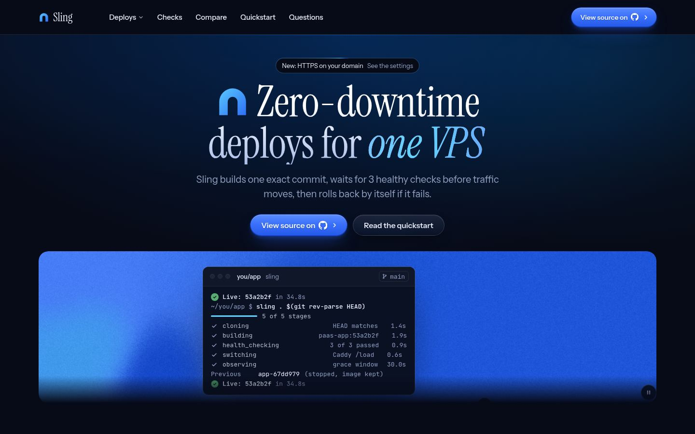
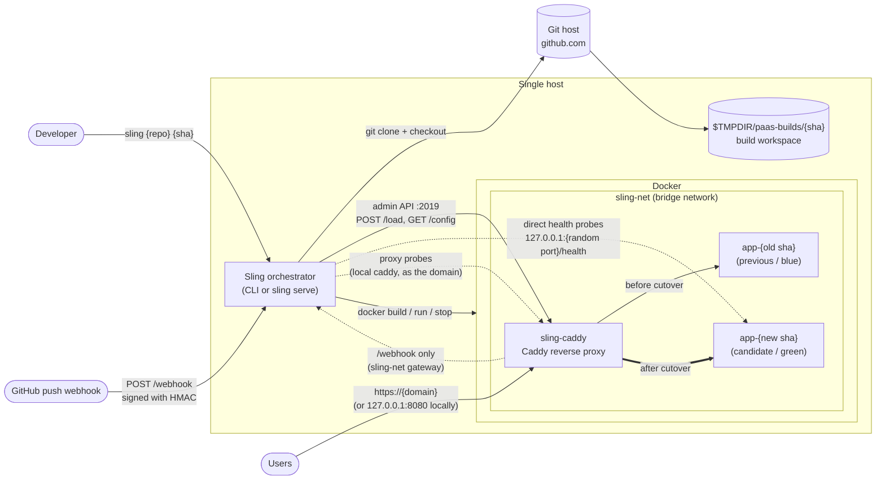
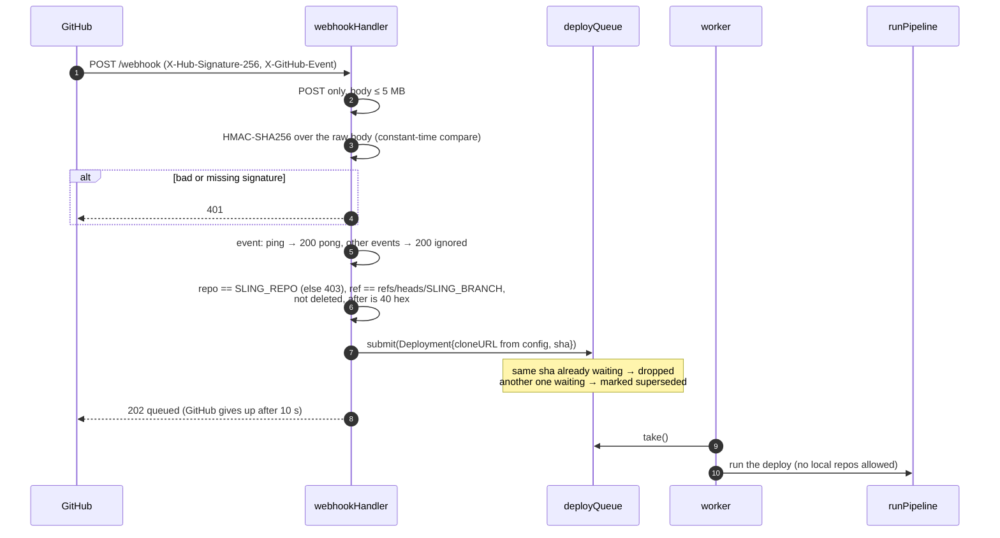
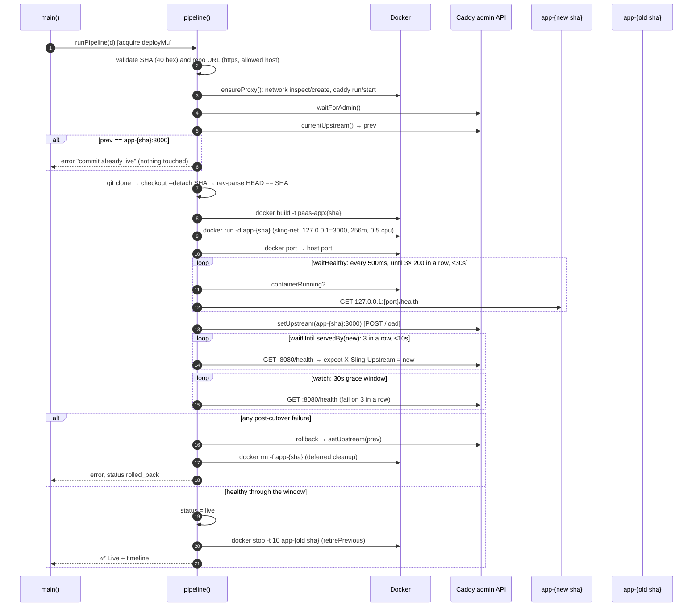
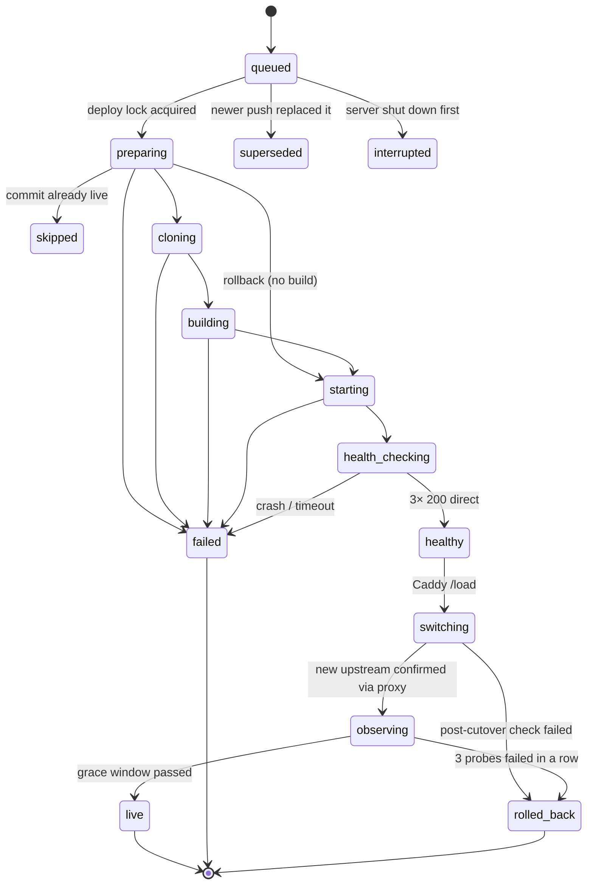
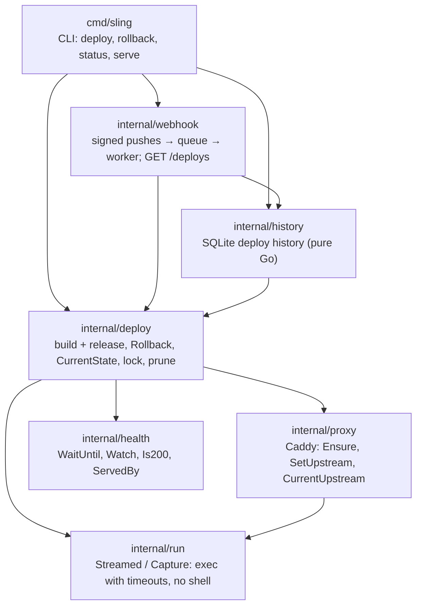

# Sling

[](https://github.com/mildlybrutal/sling-orchestrator/actions/workflows/main.yaml)
[](https://sling-tawny.vercel.app/)

<a href="https://sling-tawny.vercel.app/"></a>

**Push a commit, and it goes live with no downtime or rolls itself back.**
Sling is a small self-hosted deploy orchestrator written in Go. You give it a git
repo and an exact commit. It builds a Docker image, starts the new version beside
the old one, proves it is healthy, switches a Caddy proxy over to it, and keeps
watching. If anything fails along the way, traffic goes back to the previous version.

```
go run ./cmd/sling https://github.com/you/app <40-char-commit-sha>
```

<p align="center">
  
</p>

<sub>A real run of <a href="scripts/demo.sh"><code>scripts/demo.sh</code></a>: a good deploy, a crash
on boot that never gets traffic, and a release that goes live, starts failing and is rolled back
on its own. Pauses are shortened so the 30s grace window plays in about two seconds. The
durations Sling prints are real.</sub>

---

## The problem it solves

Deploying to your own server usually looks like this: SSH in, `git pull`,
`docker compose up -d --build`, and hope. That approach has a few problems:

- **Downtime on every deploy.** The old container is stopped before the new one is ready.
- **Broken releases reach users.** Nothing checks that the new version works
  before it gets traffic. A crash on boot or a failing `/health` means an outage.
- **Manual, stressful rollbacks.** When a release is bad, you are back on SSH
  rebuilding the old version while users wait.
- **"What is actually running?"** Branch names move. Without pinning, the
  server can end up on a different commit than the one you meant to ship.

Hosted platforms (Heroku, Render, Railway) solve this, but they cost money and
run your app on their infrastructure. Sling brings the same safety to a single
VPS that you own.

## What Sling guarantees

| Guarantee | How |
|---|---|
| **Builds exactly the commit you asked for** | Only full 40-hex SHAs are accepted. After `git checkout --detach` it compares `git rev-parse HEAD` with the SHA you gave it. |
| **No downtime** | The new container runs beside the old one. The proxy switches only after the new one passes its health checks. |
| **A broken build never gets traffic** | It needs 3 healthy `/health` responses in a row from the container directly. If the container crashes, the check fails at once. |
| **It checks the new version is the one answering** | After the switch it probes through the proxy and requires the `X-Sling-Upstream` header to name the *new* container, not just "something answered 200". |
| **Automatic rollback** | If the post-switch check or the 30s grace window fails (3 probes in a row), the proxy is pointed back at the previous version. |
| **Old connections finish cleanly** | The previous version is stopped with `docker stop` (SIGTERM, 10s to finish), not killed, and its image is kept, so `sling rollback` can bring it back in seconds, with no rebuild and through every check. |
| **Resource limits** | Each app gets 256 MB of memory and 0.5 CPU, and its port is reachable only from the server itself (loopback). |
| **One deploy at a time** | A lock stops two deploys from fighting over the proxy. |
| **Live commit is not redeployed** | Redeploying the commit that is already live is skipped before any container is touched. |
| **Only signed pushes deploy** | Webhook deliveries must carry a valid HMAC-SHA256 signature, and come from the configured repo and branch. The clone URL comes from Sling's own config, never from the payload. |
| **Bursts of pushes don't pile up** | Deploys run one at a time with at most one waiting. A newer push replaces the waiting one. |
| **HTTPS with no certificate work** | With `SLING_DOMAIN` set, Caddy obtains and renews a Let's Encrypt certificate itself, redirects HTTP to HTTPS, and forwards only `/webhook` to Sling. The admin API stays on loopback. |
| **A config mistake can't reconfigure a live site** | The proxy container records the settings it was created with. A `sling` command run with different ones (say, without `SLING_DOMAIN`) is refused before anything changes. |

## Who it is for

- **Solo developers and small teams** with one VPS who want safe, zero-downtime
  deploys without the bulk of a full self-hosted PaaS.
- **Learners** who want to see how blue/green deploys, health gating and
  rollback actually work. The codebase is small and heavily commented.

### How it compares

| | Sling | Kamal | Coolify / Dokploy | Dokku |
|---|---|---|---|---|
| Footprint | one Go binary + Caddy | Ruby gem + kamal-proxy | dashboard + DB + workers | Bash + nginx plugins |
| Confirms the new version answers through the proxy | ✅ | partial | — | — |
| Automatic rollback during a grace window | ✅ | — | — | — |
| Automatic HTTPS | ✅ | ✅ | ✅ | ✅ |
| Web UI, multiple apps | roadmap | ✅ | ✅ | ✅ |

Sling's aim is to be **the smallest tool with the strongest rollback guarantees**,
not the one with the most features.

---

## High-level design (HLD)



**Components**

- **Orchestrator** (`internal/deploy`): runs the deploy pipeline from start to finish and
  records each status change.
- **Webhook server** (`internal/webhook`): `sling serve` checks each GitHub
  push delivery and hands the commit to the deploy queue.
- **Deploy queue** (`internal/webhook/queue.go`): one worker, one waiting slot. The latest push wins,
  and a deploy that is running always finishes, even during shutdown.
- **Proxy control** (`internal/proxy`): makes sure `sling-net` and the `sling-caddy`
  container exist. It builds the Caddy JSON config and swaps the upstream
  in one step through the admin API. Two modes: local (HTTP on `127.0.0.1:8080`)
  and public (HTTPS for `SLING_DOMAIN`, with automatic certificates and a
  `/webhook` route to `sling serve`).
- **Health gate** (`internal/health`): `WaitUntil` (N passes in a row before a
  deadline) and `watch` (fail after N failures in a row during a window).
- **Status tracking** (`internal/deploy/status.go`): a status machine guarded by a mutex, with a
  timeline, ready for the planned dashboard API.

## Low-level design (LLD)

### Webhook flow



### Deploy sequence



### Deployment status machine



Not drawn: any in-progress state can end as **`interrupted`** if the Sling
process dies. The next deploy, holding the lock, finds it in the history and
marks it.

### Package map



Dependencies only point down, so there are no import cycles. `health` knows
nothing about Docker or Caddy; it is told which header to read, and how to
ask whether the container is still running.

### Key parameters

| Setting | Value | Where |
|---|---|---|
| Direct health check | every 500ms, 3 passes in a row, 30s deadline, 2s per request | `health.Default` |
| Post-cutover check | every 500ms, 3 passes in a row, 10s deadline | `postCutoverHealth` (internal/deploy) |
| Grace window | 30s, roll back after 3 failures in a row | `graceWindow`, `graceMaxFailures` (internal/deploy) |
| Timeouts | clone 1m, git 30s, build 10m, docker 30s | internal/deploy |
| Public proxy | `127.0.0.1:8080` (local) or `:80`/`:443` for `SLING_DOMAIN` | internal/proxy |
| Caddy admin | `127.0.0.1:2019` | internal/proxy |
| App container port | `3000` (published on a random loopback port) | internal/proxy |

---

## Project layout

```
.
├── cmd/sling/            # main(): parses args, runs a deploy or the webhook server
├── internal/
│   ├── deploy/           # build + release (pipeline.go), Rollback + CurrentState (state.go),
│   │                     # file lock, Deployment + statuses, retire, prune, validation
│   ├── history/          # SQLite deploy history: Save, Recent, MarkInterrupted
│   ├── health/           # probing: become healthy (WaitUntil), stay healthy (Watch)
│   ├── proxy/            # the Caddy container and its admin API
│   ├── run/              # running git/docker with timeouts, without a shell
│   └── webhook/          # sling serve: HMAC check, push filtering, deploy queue, GET /deploys
├── scripts/              # run-cases.sh (end-to-end), send-webhook.sh (fake GitHub push)
├── .env.example          # webhook settings; copy to .env (git-ignored)
├── Makefile              # build, test, test-integration, e2e, vet
└── README.md
```

`internal/` means these packages can't be imported by other modules, so their
APIs can change freely while Sling is young.

## Usage

**Requirements:** Go 1.26+, Docker, and git. Sling pulls `caddy:2.11.7-alpine` on first run.

**What your app needs:**
- a `Dockerfile` at the repo root
- to listen on port `3000`
- `GET /health` returning `200` when ready
- optionally, reading `APP_VERSION`, which Sling sets to the commit SHA

```bash
make build    # → bin/sling
./bin/sling https://github.com/you/app 0123456789abcdef0123456789abcdef01234567
# or, during development, a local path:
./bin/sling ../sling $(git -C ../sling rev-parse HEAD)
```

A successful run ends with the live container, URLs, the previous version's
state and a timeline of each stage. Deploying the commit that is already live
prints "Nothing to do" and exits 0.

### See what's deployed, and undo a deploy

```bash
./bin/sling status            # what's live, what a rollback would go back to, every kept version
./bin/sling rollback          # back to the previous version
./bin/sling rollback 67dd979  # or to any commit whose image is still on this host (full or short SHA)
```

```
Live     : app-53a2b2f…:3000 at http://127.0.0.1:8080
Rollback : sling rollback  →  67dd979

            COMMIT   CONTAINER                IMAGE
● live      53a2b2f  Up 33 seconds            built 2 hours ago
↩ previous  67dd979  Exited (0) 1 minute ago  built 3 hours ago
            399076a  -                        built 3 hours ago
```

A rollback **doesn't rebuild**: it releases the image that's already on disk,
through the same checks as a deploy (direct health check, cutover, check
through the proxy, grace window, automatic rollback if the old version is
sick too). Running it twice switches back and forth. Only one deploy or
rollback runs at a time on a host, even across processes: a second one waits
for the file lock (`$XDG_RUNTIME_DIR/sling.lock`). `status` only reads, so it
never waits.

### Deploy history

```bash
./bin/sling history       # last 20 deploys and rollbacks; `history 100` for more
```

```
STARTED          KIND      COMMIT   STATUS       TOOK  ERROR
Nov 08 16:46:22  deploy    53a2b2f  live         34s
Nov 08 16:46:20  deploy    399076a  interrupted  2s    the Sling process stopped while this deploy was health_checking
Nov 08 16:45:47  rollback  67dd979  live         33s
Nov 08 16:45:45  deploy    feb2e72  failed       2s    failed to inspect port (container may have exited): ...
```

Every status change of every deploy, whether from the CLI or `sling serve`, is saved to
a SQLite file (`$SLING_DATA_DIR/history.db`, default `~/.local/state/sling/history.db`,
mode `0600`), so history survives restarts. If Sling is killed mid-deploy, the next
deploy, which holds the lock and so knows nothing else is running, marks it
**`interrupted`** and records the stage it reached. Check `sling status` after one: a
deploy killed after the cutover may have left traffic on the new version. History
is best-effort for the CLI (it warns and deploys anyway) and required for `sling serve`.

### Deploy on `git push` (webhook server)

```bash
export SLING_WEBHOOK_SECRET=$(openssl rand -hex 32)   # required, at least 16 chars
export SLING_REPO=you/app                              # required, owner/name
export SLING_BRANCH=main                               # default: main
export SLING_LISTEN=127.0.0.1:9000                     # default: 127.0.0.1:9000
export SLING_STATUS_TOKEN=$(openssl rand -hex 32)     # optional: enables GET /deploys
./bin/sling serve
```

With `SLING_STATUS_TOKEN` set, `GET /deploys` returns what's live and the last
20 deploys (status, timeline, error) as JSON, read from the same history file,
so it includes CLI deploys and survives restarts:

```bash
curl -H "Authorization: Bearer $SLING_STATUS_TOKEN" http://127.0.0.1:9000/deploys
```

In the GitHub repo, go to **Settings → Webhooks → Add webhook** and set:
- **Payload URL:** `https://<SLING_DOMAIN>/webhook`
- **Content type:** `application/json`
- **Secret:** the same `SLING_WEBHOOK_SECRET`
- **Events:** just the push event

Without `SLING_DOMAIN` (local mode), the webhook listens on loopback only, so
GitHub can't reach it: use public mode (below) or a tunnel such as cloudflared.

### Going public: HTTPS on your domain

```bash
export SLING_DOMAIN=app.example.com     # DNS A/AAAA record must point at this server
export SLING_ACME_EMAIL=you@example.com # optional: Let's Encrypt expiry warnings
./bin/sling serve                       # or any deploy; the first one sets up the proxy
```

| Variable | Default | Meaning |
|---|---|---|
| `SLING_DOMAIN` | unset (local mode) | The one hostname to serve over HTTPS |
| `SLING_TLS` | `acme` | `acme` = Let's Encrypt; `internal` = Caddy's own CA (testing, browsers warn) |
| `SLING_ACME_EMAIL` | unset | Contact address for the certificate account |
| `SLING_WEBHOOK_PORT` | `9000` | Port `sling serve` listens on for Caddy, on the `sling-net` gateway |
| `SLING_PUBLIC_BIND` | `0.0.0.0` | Host address for ports 80/443 (`127.0.0.1` to test without exposing them) |

What changes in public mode:
- **Caddy listens on 80 and 443.** It gets the certificate on first request and renews it.
  HTTP redirects to HTTPS (308). Certificates live in the `sling-caddy-data` volume,
  so recreating the container doesn't request new ones (Let's Encrypt rate-limits that).
- **`https://<domain>/webhook` goes to Sling**, everything else to the app.
  `sling serve` gets a second listener on the `sling-net` gateway (the host as
  containers see it) that serves **only** `/webhook`. `/deploys` stays on
  `SLING_LISTEN` (loopback), never one hop from the internet.
- **Sling's own checks still go through Caddy**: they connect to the local proxy with the
  domain as SNI and Host, so they work before DNS points here, and still require
  `X-Sling-Upstream` to name the new container. They skip certificate verification
  on that loopback connection on purpose: the check is about routing, and a
  certificate problem must not roll back a healthy app.
- **Every `sling` command must see the same settings.** Put them in one env file.
  To change mode on purpose: `docker rm -f sling-caddy` (the site is down until the
  next deploy; certificates are kept).

The server needs ports 80 and 443 open to the internet (80 for the certificate
challenge and redirect). The admin API (2019) stays bound to loopback in every mode.

Try public mode on your laptop without a domain:

```bash
SLING_DOMAIN=sling.localhost SLING_TLS=internal SLING_PUBLIC_BIND=127.0.0.1 \
  ./bin/sling ../sling $(git -C ../sling rev-parse good-v1)
curl -k --resolve sling.localhost:443:127.0.0.1 https://sling.localhost/
```

Webhook deploys always clone `https://github.com/$SLING_REPO.git`; local paths
are only accepted from the CLI. The first Ctrl-C (or SIGTERM) stops accepting
webhooks and lets the deploy in progress finish. A second Ctrl-C forces an exit.

To test without GitHub, send a signed push yourself:

```bash
SLING_WEBHOOK_SECRET=... ./scripts/send-webhook.sh you/app <40-char-sha> [branch] [url]
```

The sample app in [`../sling`](../sling) includes `make-cases.sh`, which creates
commits that fail on purpose (`crash`, `bad-health`, `slow-start`) plus two
good versions, to exercise every path above.

## Testing

```bash
make test                                   # unit tests with -race (no Docker needed)
make test-integration CADDY=/path/to/caddy  # against a real Caddy binary
make e2e                                    # end to end: deploys every demo case with Docker
make demo                                   # the README recording: good deploy, crash, automatic rollback
```

`make demo` records [`scripts/demo.sh`](scripts/demo.sh) with
[`scripts/record.py`](scripts/record.py) (Python's `pty`, no other tools) and draws
[`docs/demo.svg`](docs/demo.svg) with [`scripts/cast2svg.py`](scripts/cast2svg.py).
It needs the demo app's `fails-later` tag: a commit whose `/health` passes at first and
returns 500 ten seconds after boot, so the release goes live and then has to be rolled back.

## Roadmap

- [x] Clone, build and run with exact commit pinning and input validation
- [x] Health gate before any traffic is routed
- [x] Caddy blue/green switch with a check that the new version answers
- [x] Grace window with automatic rollback, and stopping the old version cleanly
- [x] Webhook server (deploy on `git push`): signed deliveries, a queue where the latest push wins, clean shutdown
- [ ] Multiple apps with a lock per app and routing per domain
- [x] `sling status`, `sling rollback [sha]`, and a `GET /deploys` status API
- [x] One deploy at a time per host, across processes (file lock)
- [x] Persistent deploy history (SQLite), `sling history`, crash detection (`interrupted`)
- [ ] Dashboard
- [x] HTTPS through Caddy's automatic certificates, with `/webhook` routed to Sling
- [x] Cleanup of old containers, images and build folders
